# The World That Day

See the place you were born, as it looked around the day you arrived.

Enter a date of birth (1950 or later) and a birthplace in Canada. The result tells a short story with photos, videos and numbers: what that place looked like around that day, what life cost back then compared with now, and what happened in the world on that exact date.

> **Direction change, 2026-10-29.** The project started as a South Korea service (M0–M3 below). The PM moved it to Canada: the screen is in Canadian English (en-CA), world events come from English Wikipedia, and a new "then and now" section compares that year with today. The Korean place and newsreel work is paused.

## The result, as a story

1. **Opening**: "Saturday, July 17, 1976 at 3:20 p.m., Hochelaga-Maisonneuve, Montréal"
2. **The neighbourhood that day**: aerial photos from around the birth year next to today's view, where an archive exists
3. **Scenes of the city**: archive photos and videos of landmarks that existed that year
4. **Then and now**: $100 then in today's dollars, a basket of everyday prices, minutes of minimum-wage work, the weather that day, popular baby names and the city's population
5. **The world that day**: events on the same date in Canada and around the world, with photos and videos that play right on the page
6. **Closing**: every source used, and a way to try another date or place

Every photo, video and number shows its source and the period it really covers (that day / that week / that month / that year / ±N years / present day). Nothing is presented as "from that day" unless it was. An event that started that day and ran for weeks says so ("Started that day — ran until February 28").

## Progress

```mermaid
flowchart LR
    K["M0–M3<br/>Korea version"]:::done
    C0["C0<br/>Canada research"]:::done
    C1["C1<br/>Country switch"]:::doing
    C2["C2<br/>Place resolution"]:::next
    C3["C3<br/>Then and now"]:::next
    C4["C4–C5<br/>Then-and-now items"]:::todo
    C8["C8<br/>Story polish and demo"]:::todo
    K --> C0 --> C1 --> C2 --> C3 --> C4 --> C8

    classDef done fill:#2e7d32,color:#fff,stroke:#1b5e20
    classDef doing fill:#f9a825,color:#000,stroke:#f57f17
    classDef next fill:#90caf9,color:#000,stroke:#1565c0
    classDef todo fill:#eeeeee,color:#555,stroke:#bdbdbd
```



| Milestone | Scope | Status |
|---|---|---|
| M0–M3 Korea version | Source research, server and web skeleton, "the world that day" with event photos and videos, shared media card, privacy policy and consent | ✅ Done (PR #1–#29) |
| C0 Canada research | Verified sources for place search, aerial imagery, events, archive media, prices, wages, names, population, weather and privacy | ✅ Done (PR #30) |
| C1 Country switch | S1 English screen ✅ (PR #31) · S2 input form and opening in en-CA 🟡 in review (PR #33) · S3a events from English Wikipedia 🟡 in progress · S3b "YYYY in Canada" events · S3c media scoped to Canada · S4 Canadian YouTube channels (needs PM setup) | 🟡 In progress |
| C2 Place resolution | Canadian place dictionary (Statistics Canada geography and the Canadian Geographical Names Database), `GET /api/places/resolve`, picking between same-name places | ⚪ Planned |
| C3 Then and now | Shared format for honest numbers, $100 then vs now (Consumer Price Index), minutes of minimum-wage work | ⚪ Planned |
| C4–C5 More items | Weather that day, popular baby names, city population; later interest rates, Stanley Cup, house prices | ⚪ Planned |
| C6–C7 Neighbourhood and city scenes | Aerial then-and-now and landmark archives where sources allow | ⚪ After the MVP |
| C8 Story polish and demo | Story flow, full source list, failure isolation, end-to-end demo | ⚪ Planned |

Demo inputs (synthetic, not real people): 1988-02-13 Calgary, 1976-07-17 Hochelaga-Maisonneuve, Montréal, 2010-02-12 Vancouver General Hospital, 1980-04-12 St. John's. See the [roadmap](docs/roadmap.md) for feature-level detail.

## Tech stack

- Server: Java 21, Spring Boot 4.1, Spring Data JPA, PostgreSQL 17, Flyway, Gradle
- Web: React, TypeScript, Vite
- Tests: JUnit 5, Testcontainers, WireMock / Vitest, Testing Library, MSW, Playwright
- CI: GitHub Actions (`server-ci`, `web-ci`)

## Running locally

Docker must be running. All commands start from the repository root.

```bash
cp .env.example .env    # then set POSTGRES_PASSWORD
docker compose up -d db
```
```bash
cd server && ./gradlew bootRun    # http://localhost:8080/api/health
```
```bash
cd web && npm ci && npm run dev   # http://localhost:5173
```

Tests: `cd server && ./gradlew check` and `cd web && npm test` (browser tests: `npm run e2e`). Tests never call external services; they use recorded or synthetic fixtures.

**▶ PM (Eric) decision, 2026-10-24**

Clone the repository outside any cloud-synced folder (for example `~/Projects`, not iCloud Desktop or Documents). Sync tools create duplicate files such as `V1__baseline 2.sql` or `Foo 2.java`, even inside `.git`. Those copies broke Flyway migrations and the formatting check during M3a4, so on 2026-10-24 the working copy moved from the iCloud-synced Desktop to `~/Projects/The-World-That-Day` (a fresh clone). If a build ever shows such copies, run `./gradlew clean` and move the clone.

## How it is built

The project is run by a human PM directing an AI agent team. An orchestrator session assigns work to seven role-specific agents (planner, data-researcher, content-curator, backend-dev, frontend-dev, test-engineer, code-reviewer) under the rules in [CLAUDE.md](CLAUDE.md):

- Every feature starts with a written plan that the PM approves before any code is written.
- Each feature is one branch and one PR, kept to roughly 400 lines of product code.
- Each PR goes through tests written against the plan's acceptance criteria and an independent code review before the PM merges it.
- External data sources are used only after they are verified from official documentation.

Product docs (brief, roadmap, plans, research) are written in Korean for the PM; code, commits, PRs and agent rules are in English.

## Documents

- [Product brief](docs/product-brief.md): source of requirements (Korean)
- [Roadmap](docs/roadmap.md): milestones and order (Korean)
- [Canada research summary](docs/research/canada-summary.md): verified sources, item verdicts and decisions (Korean)
- [Korea research summary](docs/research/summary.md): the earlier Korea version (Korean)
- [Progress log](docs/progress.md): per-task record
- [Agent team rules](CLAUDE.md) and [agent definitions](.claude/agents/)
- [PM kickoff guide](docs/PM_KICKOFF.md): how the project was set up
