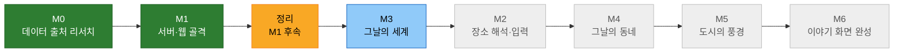

# The World That Day

See the place you were born, as it looked around the day you arrived.

생년월일과 태어난 장소를 입력하면, **그날 그곳의 대한민국 풍경**과 **그날 세계에서 일어난 일**을 사진과 짧은 영상으로 한 편의 이야기처럼 보여 주는 서비스입니다.

## 결과 화면 흐름

1. **오프닝**: "1988년 9월 17일 토요일, 서울"
2. **그날의 동네**: 출생 연도 무렵의 항공사진과 지금 모습을 나란히 보여 주고, 로드뷰와 동네 곳곳 사진을 보여 줍니다
3. **그 도시의 풍경**: 그해에 있던 대표 명소의 기록 사진·영상
4. **그날의 세계**: 같은 날짜에 일어난 국내외 사건과 사진·영상
5. **마무리**: 쓰인 출처 전체 목록, 다른 날짜나 장소로 다시 해 보기

모든 사진과 영상에는 출처와 실제 촬영 시점(같은 날 / 같은 해 / ±N년 / 현재 모습)을 표시합니다.

## 진행 상황



| 단계 | 내용 | 상태 |
|---|---|---|
| M0 데이터 출처 리서치 | 장소 검색, 항공사진, 지도·로드뷰, 기록 사진·영상, 그날의 사건 출처 검증 | ✅ 완료 (PR #1) |
| M1 부트스트랩 | `server/`(Spring Boot + PostgreSQL), `web/`(React) 골격, CI, 빈 결과 화면 | ✅ 완료 (PR #2, #3) |
| M1 후속 정리 | CI 경로, `.env.example` 정리, 실행 명령 문서화 | 🟡 진행 중 |
| M3 그날의 세계 | 날짜별 사건, 사건 사진·영상, 디자인 기초와 공용 미디어 카드 | 🔵 계획 중 |
| M2 장소 해석과 입력 | 입력한 장소를 광역/동네/지점으로 분류, 후보 선택, 오프닝 | ⚪ 예정 |
| M4 그날의 동네 | 항공사진 그때/지금, 로드뷰, 동네 곳곳 | ⚪ 예정 |
| M5 도시의 대표 풍경 | 시·도별 대표 명소와 기록 미디어 | ⚪ 예정 |
| M6 이야기 화면 완성 | 화면 흐름, 성능, 출처 목록, 데모 준비 | ⚪ 예정 |

M2보다 M3를 먼저 하는 이유: 사건 데이터는 장소와 상관없이 날짜만으로 결과를 낼 수 있고, 출처가 모두 검증돼 있으며 API 키도 필요 없습니다. 자세한 순서와 기능 단위는 [로드맵](docs/roadmap.md)에 있습니다.

## 기술 스택

- 서버: Java 21, Spring Boot 4.1, Spring Data JPA, PostgreSQL 17, Flyway, Gradle
- 웹: React, TypeScript, Vite
- 테스트: JUnit 5, Testcontainers / Vitest, Testing Library, MSW
- CI: GitHub Actions (`server-ci`, `web-ci`)

## 실행 방법

Docker가 실행 중이어야 합니다. 명령은 모두 저장소 루트에서 시작합니다.

```bash
cp .env.example .env    # POSTGRES_PASSWORD 값을 채웁니다
docker compose up -d db
```
```bash
cd server && ./gradlew bootRun    # http://localhost:8080/api/health
```
```bash
cd web && npm ci && npm run dev   # http://localhost:5173
```

테스트는 `cd server && ./gradlew check`, `cd web && npm test`로 돌립니다.

## 문서

- [제품 정의서](docs/product-brief.md): 요구사항의 원천
- [로드맵](docs/roadmap.md): 마일스톤과 진행 순서
- [데이터 출처 리서치 요약](docs/research/summary.md): 출처별 검증 결과와 결정 목록
- [진행 로그](docs/progress.md): 작업별 기록
- [작업 규칙](CLAUDE.md): PM과 에이전트 팀의 운영 방식
