# The World That Day

See the place you were born, as it looked around the day you arrived.

Enter a date of birth and a birthplace in South Korea. The result tells a short story with photos and videos: what that place looked like around that day, and what happened in the world on that exact date.

## The result, as a story

1. **Opening**: "Saturday, September 17, 1988 — Seoul"
2. **The neighborhood that day**: aerial photos from around the birth year next to today's view, plus street view and photos from around the neighborhood
3. **The city's landmarks**: archive photos and videos of landmarks that existed that year
4. **The world that day**: events on the same date in Korea and around the world, with photos and videos that play right on the page
5. **Closing**: every source used, and a way to try another date or place

Every photo and video shows its source and when it was actually taken (same day / same year / ±N years / current view). Nothing is presented as "from that day" unless it was.

## Progress

```mermaid
flowchart LR
    M0["M0<br/>Data source research"]:::done
    M1["M1<br/>Server and web skeleton"]:::done
    C["Cleanup<br/>M1 follow-ups"]:::done
    M3["M3<br/>The world that day"]:::doing
    M2["M2<br/>Place resolution and input"]:::todo
    M4["M4<br/>The neighborhood"]:::todo
    M5["M5<br/>The city's landmarks"]:::todo
    M6["M6<br/>Story polish and demo"]:::todo
    M0 --> M1 --> C --> M3 --> M2 --> M4 --> M5 --> M6

    classDef done fill:#2e7d32,color:#fff,stroke:#1b5e20
    classDef doing fill:#f9a825,color:#000,stroke:#f57f17
    classDef next fill:#90caf9,color:#000,stroke:#1565c0
    classDef todo fill:#eeeeee,color:#555,stroke:#bdbdbd
```



| Milestone | Scope | Status |
|---|---|---|
| M0 Data source research | Verify sources for place search, aerial photos, maps and street view, archive media, and day-of events | ✅ Done (PR #1) |
| M1 Bootstrap | `server/` (Spring Boot + PostgreSQL) and `web/` (React) skeletons, CI, empty result screen | ✅ Done (PR #2, #3) |
| M1 follow-ups | CI path filter, `.env.example` cleanup, documented commands | ✅ Done (PR #4) |
| M3 The world that day | Events by exact date for any birth date, event photos and videos, design foundation and shared media card | 🟡 In progress (17 of 21 PRs merged) |
| M2 Place resolution and input | Classify the place as region / neighborhood / spot, pick from candidates, opening line | ⚪ Planned |
| M4 The neighborhood | Then-and-now aerial photos, street view, neighborhood photos | ⚪ Planned |
| M5 The city's landmarks | Curated landmarks per region with archive media | ⚪ Planned |
| M6 Story polish and demo | Story flow, performance, source list, demo | ⚪ Planned |

### M3 in detail

| Feature | Status |
|---|---|
| Video source research (Commons, official YouTube channels, 대한뉴스, provider embeds) | ✅ Done (PR #9) |
| M3a1 Korean Wikipedia client and event parser | ✅ Done (PR #5) |
| M3a1b Wikipedia call hardening and section cache | ✅ Done (PR #8) |
| M3a1c Merge and dedup events across pages | ✅ Done (PR #10) |
| M3a2 "The world that day" API | ✅ Done (PR #11) |
| M3a3 Shared media format and rules | ✅ Done (PR #12) |
| M3a3a Media checks: capture time, license status, blocklist | ✅ Done (PR #14) |
| M3a3b Day photos from Wikimedia Commons | ✅ Done (PR #17) |
| M3a3c Event photo parts: shared deadline, PageImages, Commons file batch | ✅ Done (PR #20) |
| M3a3d Event photos in the world API | ✅ Done (PR #22) |
| M3a4 Video search framework and accuracy rules | 🟡 In review |
| M3a4b Commons videos and result cache | ⚪ Planned |
| M3a5 Official YouTube channel videos (KTV archive) | ⚪ Planned, API key ready |
| M3a5b 대한뉴스 newsreel matching | ⚪ Planned, needs a one-time index |
| M3b1 Design tokens and media label rules | ✅ Done (PR #6) |
| M3b1b Shared media card | ✅ Done (PR #7) |
| M3b2 "The world that day" section | ✅ Done (PR #13) |
| M3b2b Day photos, tragic-event block, card accessibility, browser tests | ✅ Done (PR #15) |
| M3b3 Inline video playback (Commons) | ✅ Done (PR #16) |
| M3b3b Privacy policy and consent step | ✅ Done (PR #18) |
| M3b3c Official YouTube embeds | ✅ Done (PR #21) |

Provider image embeds (Getty and others) were dropped from M3: automatic search needs a paid contract. They will be reconsidered at the public deployment decision.

M3 comes before M2 because events depend only on the date, their sources are already verified, and they need no API keys. See the [roadmap](docs/roadmap.md) for feature-level detail.

## Tech stack

- Server: Java 21, Spring Boot 4.1, Spring Data JPA, PostgreSQL 17, Flyway, Gradle
- Web: React, TypeScript, Vite
- Tests: JUnit 5, Testcontainers / Vitest, Testing Library, MSW
- CI: GitHub Actions (`server-ci`, `web-ci`)

## Running locally

Docker must be running. All commands start from the repository root.

```bash
cp .env.example .env    # then set POSTGRES_PASSWORD
docker compose up -d db
```
```bash
cd server && ./gradlew bootRun    # http://localhost:8080/api/health
```
```bash
cd web && npm ci && npm run dev   # http://localhost:5173
```

Tests: `cd server && ./gradlew check` and `cd web && npm test`.

Clone the repository outside any cloud-synced folder (for example `~/Projects`, not iCloud Desktop or Documents). Sync tools create duplicate files such as `V1__baseline 2.sql` or `Foo 2.java`, even inside `.git`. Those copies broke Flyway migrations and the formatting check during M3a4, so on 2026-10-24 the working copy moved from the iCloud-synced Desktop to `~/Projects/The-World-That-Day` (a fresh clone). If a build ever shows such copies, run `./gradlew clean` and move the clone.

## How it is built

The project is run by a human PM directing an AI agent team. An orchestrator session assigns work to seven role-specific agents (planner, data-researcher, content-curator, backend-dev, frontend-dev, test-engineer, code-reviewer) under the rules in [CLAUDE.md](CLAUDE.md):

- Every feature starts with a written plan that the PM approves before any code is written.
- Each feature is one branch and one PR, kept to roughly 400 lines of product code.
- Each PR goes through tests written against the plan's acceptance criteria and an independent code review before the PM merges it.
- External data sources are used only after they are verified from official documentation.

Product docs (brief, roadmap, plans, research) are written in Korean for the PM; code, commits, PRs and agent rules are in English.

## Documents

- [Product brief](docs/product-brief.md): source of requirements (Korean)
- [Roadmap](docs/roadmap.md): milestones and order (Korean)
- [Data source research summary](docs/research/summary.md): verification results and decisions (Korean)
- [Progress log](docs/progress.md): per-task record
- [Agent team rules](CLAUDE.md) and [agent definitions](.claude/agents/)
- [PM kickoff guide](docs/PM_KICKOFF.md): how the project was set up
